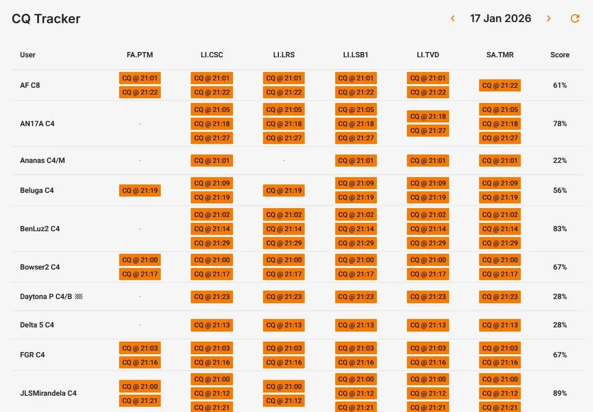

<section class="section pt-9 pb-7" markdown="1">

## O Treino semanal chega às redes Meshtastic e MeshCore

A partir de 27 de Setembro de 2025, além do rádio (CB e PMR446), o treino passa também a decorrer nas redes **Meshtastic** e **MeshCore**, em simultâneo, **todos os sábados às 21:00**.

Meshtastic e MeshCore são redes de mensagens de texto (tipo SMS) baseadas em **LoRa**, ideais para cenários *offgrid*, com grande alcance e baixo consumo, graças à comunicação **em malha (mesh)**.

## Quando e onde

- **Dia/Hora:** Sábados, **21:00–22:00** (hora de Portugal continental).

- **Plataformas:**  **Meshtastic** e **MeshCore**.

- **Canais:** Em cada rede será aberto **um canal próprio** dedicado ao treino 3‑3‑3.

Meshtastic

**Dados para configuração do canal:  
Nome do Canal**  –  Plano\_3-3-3  
**PSK**  –  AlRIqQuRL8WUxq2xIk2xjxJenYAXvzjCT8nY2lFnx2k=  
**UpLink**  –  Desligado  
**Downlink**  –  Desligado

Durante o treino, pode ainda ser desligada a opção que permite o acesso da aplicação à internet de forma a garantir que nenhuma das mensagens será enviada ou transportada via internet, ou mesmo desligar o wifi / dados móveis do telemóvel.

Na opção MQTT:  
**Proxy to Client**  –  Desligado

Veja as instruções [aqui](#instrucoes).



MeshCore

**Dados para configuração do canal:**  
Na opção ‘Join a Hashtag Chanel’:  
**Canal (hashtag)** –  #plano333

 Para configuração manual:  
**Secret key**  –  8d40917d08edeeb33e85c1a2308a2221

Uma vez que o MeshCore nunca utiliza a internet e toda a comunicação é feita exclusivamente por RF, não é necessário ter qualquer cuidado adicional para além da correta configuração do canal.

Veja as instruções [aqui](#instrucoes).



> O treino em Meshtastic e MeshCore decorre **em simultâneo** com o treino via rádio.

---

## Como funciona

### 1) Emissão de presenças:

##### **Meshtastic: 21:00–21:30 MeshCore: 21:00-22:00**

Cada utilizador envia **até 3 mensagens** no período de 30 minutos, com **este formato recomendado**:

CQ Plano 333, Nome de estação, cidade, localidade  
**Exemplo: CQ Plano 333, Mike 05, Lisboa, Olaias**

**�**
{: .step}

**2) Confirmações — 21:30–22:00 (Apenas Meshtastic)**
{: .step}

Entre as 21:30 e as 22:00, **cada estação responde** (nas redes Meshtastic/MeshCore) **indicando todas as estações das quais recebeu mensagem**. Use **este formato**:

QSL, nome de estação, nº de hops, local  – várias linhas ou mensagens se necessário

**Exemplo:**  
QSL, Daytona, 5 hops, Tomar  
QSL, Rat, 3 hops, Tomar  
QSL, Kapa,2 hops, Tomar

> *Nota:* O **nº de hops** (saltos) é o número de encaminhamentos em malha que a sua mensagem percorreu até chegar ao destino.

**3) Relatório de contactos**
{: .step}

**Meshtastic:**  
Os utilizadores do Meshtastic deverão fazer um relatório resumido�na página de telegram dos contactos recebidos, para que aqueles que possam não ter recebido a QSL saibam que o seu CQ foi visto. Cada contacto deve incluir o nome e o local da estação recebida, assim como o número de hops.

**MeshCore:**  
Os utilizadores do MeshCore poderão consultar os locais onde a sua mensagem chegou através do relatório elaborado com os dados recolhidos pelos observadores. O relatório pode ser visto no site [https://www.meshcore.pt/pt/projects/plano333](https://www.meshcore.pt/pt/projects/plano333).

---

## Regras rápidas

- **Máximo 3 envios** por estação no período 21:00–21:30.

- Use **sempre o mesmo identificador** de estação que utiliza no rádio (se aplicável).

- **Seja conciso** e siga o formato indicado para facilitar o apuramento e a validação.

- Faça **teste prévio** de equipamento/app e verifique se está no canal próprio do treino.

- Respeite **o Canal**e evite tráfego fora dos horários do treino ou que não sigam o formato do treino.

---

## Porquê esta expansão?

Adicionar Meshtastic e MeshCore ao treino semanal reforça a **resiliência** das comunicações do Plano 3‑3‑3, oferecendo mais **redundância**, **alcance** e **diversidade** em contextos de emergência ou falhas de infraestrutura.

---

## Saiba mais

- O que é o **Plano 3‑3‑3** e como participar: [**www.plano333.pt**](/)

Seja parte da rede. **Sábado, 21:00** — encontramos‑nos no éter… e na malha! 💬📻

</section>
