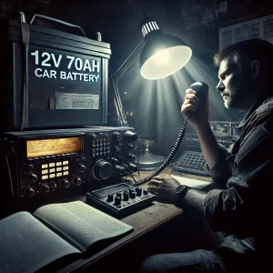

<section class="section pt-9 pb-4" markdown="1">

## Treino semanal do Plano 3-3-3 em modo Off Grid

**E se faltar a eletricidade?** Vai conseguir comunicar? Se for em portátil, como o PMR 446 sim, ou se estiver com um CB em móvel, no carro, mas e em base? As estações de CB de base são as que têm maior alcance e ajudam a passar as mensagens entre outras estações mais fracas. É muito importante que estas estações existam. e estejam operacionais.  Assim, e por proposta da estação, Xaral de Porto de Mós, inicia-se agora um treino diferente, o **Treino Off Grid.** Este treino é em tudo idêntico ao já conhecido Treino Semanal do Plano 3-3-3, mas em que as estações que operem no modo Off Grid assinalam a sua presença adicionando o sufixo /O a seguir ao seu indicativo ou nome de estação. Desta forma, a estação Xaral será Xaral /O e a minha, Mike 05 /O. É tão simples como isto, adicional  /O no final. É também possível utilizar outras variantes mais extensas como /Oscar, /Offgrid ou simplesmente dizer Off Grid. **Para ser considerada Off Grid** uma estação não pode ser alimentada pela energia da rede, **terá de operar a partir de uma bateria por exemplo**. Os portáteis já são por natureza considerados Off Grid e as estações em móvel também. No entanto, no Treino Semanal do Plano 3-3-3, e porque nos preparamos para operar em condições extremas, sugiro que considerem que além da falta de energia elétrica, também os meios de comunicação usuais, telefone e Internet tenham falhado. Nenhuma comunicação deve ser feita com exceção da informação de QRK. Até mesmo a luz da divisão da casa onde se encontrem deve ser independente da rede, por exemplo lanterna, *power bank* ou iluminação a 12V. Recomenda-se que o registo seja feito em papel evitando-se o computador, a não ser que este seja também alimentado por uma fonte de energia alternativa. São consideradas Off Grid os seguintes tipos de estação:
{: style="margin-bottom: 0"}

- **Base CB alimentadas a bateria**
- **Móvel CB** (já são Off Grid por natureza)
- **Portátil CB** ou PMR 446 (já são Off Grid por natureza)

Com este treino Off Grid pretende-se sensibilizar as pessoas, família ou grupos, para a necessidade de terem os seus meios de energia alternativa. Cada um deverá escolher a sua solução, melhorando constantemente por forma a estar bem preparado para quando for necessário. Esta iniciativa que começa por alimentar os equipamentos de rádio comunicações, é o princípio que lhe permitirá identificar outras necessidades energética em caso de falha da rede pública. Iluminação, carregamento de telemóveis, Internet, computador e até o frigorífico, são outros equipamentos que provavelmente irá querer manter com energia no caso de um apagão. Como complemento a um *Power Bank* ou bateria, a energia solar é geralmente a melhor solução para gerar energia e recarregar as baterias. O utilizador poderá assim melhorar o seus sistema de energia alternativa, muito útil em caso de falha prolongada da rede elétrica.

</section>
