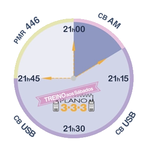

<section class="section" style="--pb-md: 80px; --pb-sm: 80px" markdown="1">

## Guia do Treino do Plano 3-3-3 em CB

O treino semanal tem o objetivo de facilitar o contacto entre todas as estações participantes. Conta com uma estrutura organizada por coordenadores treinados para orientação das restantes estações. Na sua região pode não haver coordenador e assim cada estação deverá fazer os contactos de forma independente.

**Todos os sábados, às 20:57** ligue o CB no canal 3 em AM. Verifique se a sua estação está a funcionar corretamente e prepare-se para registar os contactos.

- Às 21:00 em ponto inicia-se o treino semanal do Plano 3-3-3.
- **Não fique só à escuta**. Chame. Se não chamar, ninguém saberá que está no rádio.
- Diga o seu indicativo ou nome de estação e **faça uma chamada geral**: ex:”*Chamada geral chamada geral, Treino semanal do Plano 3-3-3, aqui “Bravo Sierra” em Lisboa, está alguém à escuta?”*
- Fique à escuta por um ou dois minutos e volte a chamar, repetindo este processo as vezes que forem necessárias.
- **Se alguém responder ou ouvir uma chamada, mantenha contacto.**Peça a localização dessa estação, nome ou indicativo.
- Confirme como essa estação o escutou e, se possível, com que sinal (QRK).
- Procure no primeiro contacto saber se existe  estação coordenadora e qual é.
- **Registe o contacto para mais tarde saber a quem chega e a que local.**
- Dê espaço para outras estações responderem e evite comunicações com mais de 30 segundos.
- Caso não haja estação coordenadores, e contacte duas ou mais estações, peça-lhes que confirmem se se escutam umas às outras.
- **Não fique à conversa no canal do treino**. Se desejar conversar peça para mudar de canal, deixando esta frequência livre para quem queira participar no treino, ou faça-o apenas depois do treino ser encerrado.
- **Às 21:10, caso não existam mais estações a responder em AM, passe para banda lateral superior, USB** e volte a chamar.
- Pelas 21:40 o coordenador chama uma a uma as estações que participaram no treino, solicitando-lhes que informem as estações que conseguiram contactar.
- **Às 21:45, termina o treino em CB**. O coordenador  agradece a participação das estações, anuncia o início do treino em PMR 446 e mais alguma mensagem final se houver. O canal 3 do CB fica livre para outras comunicações.
- Das 21:45 até às 22:00 é o treino em PMR 446. A estações que desejem participar devem deslocar-se para um local de melhor cobertura e iniciar as chamadas. O treino em PMR 446 não tem coordenação. Chame as vezes que entender até conseguir contacto.

Poderá acompanhar o treino online via [Telegram](https://t.me/Radio_SolucoesOffgrid/56149). Serve apenas para reportar as estações que são contactadas bem como outras informações escritas. O treino apenas é feito via rádio CB e PMR 446.

No caso de catástrofe generalizada ou emergência, as comunicações do Plano 3-3-3 desenvolvem-se igualmente no canal 3 mas possivelmente sem coordenação, estando cada estação responsável pelas suas comunicações e do seu grupo. O treino visa dotar as estações das competências necessárias nas rádio comunicações e a criarem o seu grupo de contacto.

## O Primeiro Treino

É o seu primeiro treino?

Nós ajudamos. O importante é experimentar, aprender e ganhar experiência em comunicações via rádio.

Escolha o seu nome de estação.

Escolha previamente o seu nome de estação, que será o nome pelo qual será conhecido. Convém ir mantendo o mesmo nome ao longo dos treinos, mas, se mais tarde preferir, pode altera-lo.  
O nome de estação pode ser qualquer alcunha ou expressão que queira usar, não sendo necessário usar o seu nome próprio.  
Pode usar qualquer expressão curta, preferencialmente que não seja muito comum, para evitar que já esteja a ser usada por outras pessoas.  
Exemplos para nome de estação: ‘pinguim’, ‘meia rota’, ‘zé da rolha’, ‘lobo branco’, ‘Pedrito74’, etc.

Ligue o rádio no Canal 3 à hora do treino.

Basta ter um rádio CB ou PMR 446 para participar.

- 21:00 – 21:10   **CB em AM**
- 21:10 – 21:45   **CB em USB**
- 21:45 – 22:00   **PMR 446**

Espere ouvir uma chamada, e responda.

Ser-lhe-á pedido o seu nome de estação e a sua localização aproximada (nome da zona, do bairro, da localidade). Não lhe será pedido nem deve indicar a sua morada.  
É comum ser perguntado o seu nome real (nome do operador), poderá ou não dar essa informação. Não é obrigatório dizer quem é, sendo sempre opção sua identificar-se ou não.  
Aproveite para informar que é o seu primeiro treino para que o possam ajudar.  
Um exemplo de resposta seria: “Daqui Pedrito74 a falar a partir de Loures. É o primeiro treino do 3-3-3 em que participo.”

Se não escutar uma chamada, faça uma.

Em zonas onde não há um coordenador, as estações devem chamar-se entre elas.

O coordenador é quem inicia a chamada, porém na ausência de um, os restantes participantes (estações / operadores) devem tomar a iniciativa de fazer uma primeira chamada (chamada geral) para dar a conhecer que estão disponíveis para participar no treino.  
Assim sendo, se não ouvir uma chamada nos primeiros minutos, tome a iniciativa e faça uma.  
Exemplo: “Chamada geral chamada geral treino semanal do plano 3-3-3, aqui Panda Laranja de Oeiras, está alguém à escuta?”

Desfrute do treino do Plano 3-3-3

É normal irem sendo feitas novas chamadas, já usando o seu nome de estação, ao longo do resto do treino, para o ajudar a identificar que outras estações consegue contactar (escutar e ser escutado).  
Ninguém sabe fazer tudo à primeira, e o objetivo do treino é ir aprendendo esta nova forma de comunicar, e passar a sentir-se à vontade dentro da sua rede mais próxima.

</section>

<section class="section bg-white pt-6 pb-6 bg-image" style="--bg: url(/assets/images/boas-praticas.webp); --pt-md: 20px; --pb-md: 100px; --pt-sm: 20px; --pb-sm: 70px" markdown="1">

## Boas práticas
{: .c-gold}

<ul class="arrow-list" markdown="1">
<li markdown="span">Chamar preferencialmente a estação coordenadora.</li>
<li markdown="span">A estação coordenadora anuncia-se no canal fazendo a chamada geral.</li>
<li markdown="span">Durante o treino outras estações podem ser nomeadas temporariamente coordenadoras e fazerem chamada geral.</li>
<li markdown="span">Pedir oportunidade no intervalo entre comunicações e aguardar.</li>
<li markdown="span">Caso seja impossível ser escutado pela estação coordenadora, pedir a outra estação que faça de relé.</li>
<li markdown="span">Caso se desenvolva contacto ou troca de informações entre duas ou mais estações, a palavra deve voltar o mais rapidamente possível para o coordenador.</li>
<li markdown="span">Se houver necessidade de contacto entre duas estações à parte do treino, estas devem passar a outro canal, voltando ao treino logo que possível.</li>
<li markdown="span">Aguardar 3 segundos entre comunicações.</li>
<li markdown="span">Evitar comunicações longas e sobre assuntos desnecessários ao treino.</li>
<li markdown="span">Os cumprimentos às estações devem ser breves.</li>
<li markdown="span">Cessar de imediato a comunicação caso ouça o coordenador ou outra estação pedir QRX.</li>
<li markdown="span">Escutar atentamente antes de fazer qualquer chamada evitando sobremodular estações mais distantes.</li>
<li markdown="span">Esperar sempre pelo fim de um contacto entre a estação e a sua interlocutora antes de iniciar uma nova chamada ou pedir oportunidade (não falar por cima).</li>
<li markdown="span">Dizer sempre o respetivo nome de estação e de preferência também a localização.</li>
<li markdown="span">Não emitir quando o coordenador solicitar outro nome de estação ou outra área geográfica que não a sua.</li>
<li markdown="span">É expressamente proibida a utilização de palavrões ou linguagem ofensiva seja em que circunstância for</li>
</ul>

</section>

<section class="section pt-8 pb-8" markdown="1">

## Várias regiões e vários coordenadores, como estabelecer contacto ?

### Se operar como estação coordenadora deve:

- Chamar na sua região independentemente de “atropelar” outra estação coordenadora mais distante. Lembre-se que o treino decorre em várias regiões em simultâneo.
- Tentar contactar outra estação coordenadora e entre as duas comunicarem as estações que escutam.
- Promover momentos de silêncio (QRX) para que a outra estação coordenadora possa fazer chamada e tentarem contactos mais distantes ou para a sua região. Ajude a fazer estes contactos agindo como relé se necessário.

### Se operar como estação independente deve:

- Registar as estações que escuta e responder à chamada geral da coordenação.
- Opcionalmente, peça oportunidade e anuncie-se.
- Faça contactos rápidos transmitindo o nome de estação, localização e outras informações breves.
- Se não ouvir outras estações, faça uma chamada geral. Repita a chamada regularmente.

</section>

<section class="section bg-pale pt-8 pb-9" markdown="1">

## Coordenadores

Os **Coordenadores** no Plano 3-3-3 desempenham um papel fundamental na organização e condução das comunicações, especialmente durante os treinos semanais e em situações de emergência. São responsáveis por iniciar as chamadas gerais, gerir os contactos entre estações, e assegurar que a comunicação decorre de forma estruturada e eficiente. A sua experiência e localização estratégica permitem que atuem como pontos centrais na rede, ajudando a contactar estações que de outra forma não conseguiriam comunicar diretamente.

### Lista de coodenadores residentes

- Lisboa: **Mike05** – Miguel Santos
- Tomar: **Ananás** – Ana Monteiro

### Para ser estação coordenadora é necessário cumprir os seguintes critério

Cumprir as regras do treino e aderir à **ética dos coordenadores**, que inclui a disciplina, o compromisso com o plano 3-3-3 e o respeito às normas de comunicação. Durante o treino, o Coordenador pode delegar temporariamente a função a outras estações para ampliar a cobertura geográfica ou facilitar os contactos. Esta função exige organização, conhecimento técnico e a capacidade de garantir que todos os participantes sejam integrados na rede de comunicações.

- Cumprir as regras do treino do Plano 3-3-3
- Cumprir a ética dos coordenadores
- Ter experiência de coordenação

Se tem gosto pelas rádio comunicações e uma boa localização, contacte-nos e saiba como pode ser uma das estações coordenadoras do plano 3-3-3.

### Caso não exista coordenador na sua região

Se após chamada não obtiver resposta do coordenador nos primeiros 3 minutos, qualquer estação pode tentar iniciar contactos sem coordenação. Deve no entanto cumprir as regras do treino e a ética dos coordenadores na medida em que estas sejam aplicáveis. É sugerido que acompanhe o treino online pelo canal do telegram e que relate a sua situação com a finalidade de ser ajudado.

</section>

<section class="section pt-8 pb-9" markdown="1">

## Ética dos Coordenadores

A ética dos coordenadores é um conjunto de normas orientadoras para as estações que pretendam assumir a coordenação. A disciplina e o compromisso no cumprimento destas normas são fatores fundamentais para o sucesso do treino.

A estação coordenadora inicia a chamada para *Check in*de contactos.

Cada contacto é confirmado mediante nome de estação e local. Opcionalmente o nome do operador e sinal de receção.

A cada contacto novo, deve interrogar as restantes estações, ou pelo menos as que achar interessante**,** se estas escutaram a nova estação. De igual forma interrogar a nova estação se está a receber as que vão reportando. A comunicação faz-se preferencialmente através do coordenador, podendo as estações comunicar  diretamente se lhes for solicitado.

Regularmente, e quando houver intervalo sem resposta a chamadas, o coordenador deve passar a palavra a outra estação presente pedindo-lhe que faça chamada geral e dando-lhe a coordenação temporariamente. Este coordenador fará chamada geral cumprindo as regras do treino do Plano 3-3-3 informando as estações que está a contactar. Não havendo mais novas estações a responder ao coordenador temporário, a coordenação volta para o coordenador inicial.

A coordenação temporária pode ser entregue a tantas estações quantas o coordenador inicial entenda necessárias para conseguir o maior número de contactos (uma maior cobertura geográfica). Caso tenha de se ausentar do treino, o coordenador inicial pode delegar esta função noutro coordenador ou numa estação.

Em qualquer momento o coordenador inicial pode reaver a palavra interrompendo a coordenação temporária pedindo QRX.

Regularmente fazer chamada geral dando tempo para as estações mais fracas responderem. Se não houver resposta, interrogar se alguma das estações presentes escutou uma resposta. Se afirmativo, pedir para fazer de relé ou conceder-lhe a coordenação temporária.

Terminadas as comunicações em AM, o coordenador deve agradecer a participação às estações que não tenham banda lateral concedendo-lhes a palavra para reportarem com que estações fizeram contacto e para se despedirem. Pode sugerir a utilização de um SDR para que continuem a acompanhar o treino.

No final do treino chamar e agradecer todas as estações que foram contactadas. Passar a palavra a outros coordenadores temporários pedindo-lhes que agradeçam aos seus contactos. Pode ser indicado o sinal de recepção (QRK) caso haja tempo.

O treino em CB deve terminar às 21:45 anunciando que o canal fica livre para QSO informal. Pode ser sugerida a passagem a AM caso as estações sejam locais.

Anunciar que começa o treino em PMR 446 e sugerir a todos que liguem os seus rádios e se desloquem para uma posição favorável.

O treino em PMR 446 decorre sem coordenação e termina às 22:00

Regularmente o coordenador deve indicar o local onde podem deixar o QRK e convidar a que se juntem no canal do Telegram.

</section>
